[English](README.md) · **Español**

# Portafolio de ingeniería cloud con Floci

Índice público de un camino práctico desde el desarrollo backend hacia la ingeniería cloud, DevOps, SRE y la ingeniería de plataforma. Cada laboratorio vive en su propio repositorio. Este repositorio es el mapa: para qué sirve cada proyecto, qué habilidades entrena y hasta dónde llegó la reconstrucción del aprendizaje.

| Documento | English | Español |
| --- | --- | --- |
| Hoja de ruta | [roadmap.en.md](docs/roadmap.en.md) | [roadmap.es.md](docs/roadmap.es.md) |
| Metodología de aprendizaje | [learning-methodology.en.md](docs/learning-methodology.en.md) | [learning-methodology.es.md](docs/learning-methodology.es.md) |
| Stack tecnológico | [technology-stack.en.md](docs/technology-stack.en.md) | [technology-stack.es.md](docs/technology-stack.es.md) |
| Metadatos de proyectos | [schema.en.md](projects/schema.en.md) | [schema.es.md](projects/schema.es.md) |

## Introducción

El trabajo está organizado en ocho proyectos. Empiezan con una base local de nube y terminan en una plataforma interna para desarrolladores que reutiliza las ideas anteriores. Este repositorio no contiene esas aplicaciones. No las construye, no las despliega y no las prueba.

[Floci](https://github.com/floci-io/floci) es el entorno de aprendizaje porque expone APIs compatibles con AWS en la máquina local. La AWS CLI, el AWS SDK y Terraform pueden apuntar a ese emulador. Nada de esto exige una cuenta de AWS, y nada de esto es un despliegue de producción en AWS.

Las disciplinas en juego son ingeniería cloud, DevOps, ingeniería de confiabilidad del sitio (SRE) e ingeniería de plataforma. Los laboratorios de backend se escriben en Go.

Hay dos límites que se mantienen en todo el camino:

| Tipo | Ejemplos | Qué es |
| --- | --- | --- |
| APIs de AWS emuladas | S3, DynamoDB, Lambda, IAM y, cuando existan esos laboratorios, ECS u Organizations | Floci respondiendo llamadas compatibles con AWS en la máquina local |
| Procesos locales reales | Docker, el propio proceso de Floci y, más adelante, k3s, Jenkins, Prometheus o Grafana | Software que sí se ejecuta, no un plano de control emulado |

Un cliente como la AWS CLI o Terraform es software real apuntando al emulador. Apuntar un cliente a Floci no convierte al emulador en AWS.

## Filosofía de aprendizaje

El orden es manual primero, infraestructura como código después y automatización al final.

1. Entender la tecnología.
2. Configurar los recursos a mano con la Floci UI cuando ese servicio está soportado.
3. Reproducir las operaciones con la AWS CLI.
4. Escribir la configuración de Terraform a mano.
5. Experimentar, diagnosticar y validar.
6. Automatizar solo después de entender el proceso manual.

Un Makefile que ya exista en un laboratorio no sustituye los pasos 1 a 5. Los proyectos 01 y 02 ya tienen trabajo de implementación. Su estado sigue en reconstrucción del aprendizaje hasta que ese camino manual quede registrado. Las reglas completas están en la [metodología de aprendizaje](docs/learning-methodology.es.md).

## Hoja de ruta

Las tecnologías nombran el alcance de aprendizaje de cada proyecto. Un repositorio publicado puede cubrir solo una parte de ese alcance. La dificultad es una etiqueta de secuencia de este camino, no una puntuación medida. El progreso usa solo los estados definidos en [projects/projects.yaml](projects/projects.yaml).

| # | Proyecto | Descripción | Tecnologías principales | Dificultad | Progreso actual | Repositorio |
| --- | --- | --- | --- | --- | --- | --- |
| 01 | Fundamentos de nube con Floci | Entorno local con Floci para la AWS CLI, Terraform, S3, DynamoDB, el ciclo de vida de la infraestructura, el estado y entornos repetibles. | Floci, Floci UI, Docker Compose, AWS CLI, Terraform, S3, DynamoDB, SQS | Fundacional | Implementado — reconstrucción y validación del aprendizaje pendientes | `floci-cloud-foundation` — No publicado |
| 02 | Comercio orientado a eventos | Servicios en Go sobre Floci para pedidos asíncronos, idempotencia, reintentos y colas de mensajes fallidos. | Go, Lambda, API Gateway, DynamoDB, SQS, SNS, EventBridge, Step Functions | Intermedio | Implementado — reconstrucción y validación del aprendizaje pendientes | `floci-event-driven-commerce` — No publicado |
| 03 | Plataforma de entrega de contenedores | Construcción y entrega de contenedores con Docker, ECS, ECR, RDS, Redis, ALB, Jenkins y pipelines compatibles con AWS, incluidos despliegues blue/green. | Docker, ECS, ECR, RDS, Redis, ALB, CodeBuild, CodePipeline, CodeDeploy, Jenkins | Intermedio | Planificado | `floci-container-delivery` — No publicado |
| 04 | SRE y observabilidad | Señales, SLO y recuperación ante fallos con CloudWatch, Prometheus, Grafana, Loki, OpenTelemetry, Jaeger e inyección de carga y de fallos. | CloudWatch, Prometheus, Grafana, Loki, Grafana Alloy, OpenTelemetry, Jaeger, Alertmanager, k6, Toxiproxy | Intermedio | Planificado | `floci-sre-observability` — No publicado |
| 05 | Plataforma de aplicaciones en Kubernetes | Una plataforma local en k3s compatible con EKS, con Kubernetes, Helm, Kustomize, RBAC, IAM Pod Identity, Forgejo, Argo CD y GitOps. | k3s, Kubernetes, Helm, Kustomize, RBAC, IAM Pod Identity, Forgejo, Argo CD | Avanzado | Planificado | `floci-kubernetes-platform` — No publicado |
| 06 | Zona de aterrizaje multicuenta | Separación de cuentas y gobierno de seguridad con AWS Organizations, IAM, STS, SCP, CloudTrail y Terraform. | AWS Organizations, IAM, STS, SCP, CloudTrail, Terraform | Avanzado | Planificado | `floci-multi-account-landing-zone` — No publicado |
| 07 | Plataforma de analítica en streaming | Ingesta y analítica en streaming con MSK, Kinesis, Firehose, S3, Glue, Athena y OpenSearch. | MSK, Kinesis, Firehose, S3, Glue, Athena, OpenSearch | Avanzado | Planificado | `floci-streaming-analytics` — No publicado |
| 08 | Plataforma interna para desarrolladores | Proyecto final de ingeniería de plataforma, módulos reutilizables de Terraform, rutas de referencia (golden paths), Kubernetes, CI/CD, GitOps, Jenkins, observabilidad y autoservicio para desarrolladores. | Terraform, Kubernetes, CI/CD, GitOps, Jenkins, Observability | Avanzado | Planificado | `floci-internal-developer-platform` — No publicado |

| Estado | Cuándo usarlo |
| --- | --- |
| Planificado | Este índice no registra evidencia de implementación. |
| En progreso | El trabajo empezó y todavía no corresponde llamarlo implementado. |
| Implementado — reconstrucción y validación del aprendizaje pendientes | Existe un repositorio. La reconstrucción manual no está registrada como hecha. |
| Completado | La implementación y la reconstrucción del aprendizaje están registradas. |
| Archivado | Se conserva por historia y ya no está en el camino activo. |

### Enlaces a repositorios

Ningún proyecto tiene URL en este índice. Los proyectos 01 y 02 ya tuvieron una primera versión. Esas copias se hicieron privadas y se renombraron con el sufijo `-depr` para rehacer los laboratorios desde cero. Este índice no enlaza las copias retiradas.

**01 — Fundamentos de nube con Floci.** Una primera versión quedó terminada, luego se hizo privada y se renombró a floci-cloud-foundation-depr para rehacer el laboratorio desde cero. Esa copia retirada usaba la Floci UI, Docker Compose, Terraform y la AWS CLI para crear un bucket de S3, una tabla de DynamoDB y una cola de SQS en 127.0.0.1, con una validación que rechaza cualquier otro endpoint. El repositorio del portafolio todavía no está publicado.

**02 — Comercio orientado a eventos.** Una primera versión quedó terminada, luego se hizo privada y se renombró a floci-event-driven-commerce-depr para rehacer el laboratorio desde cero. Ese Terraform retirado incluía API Gateway, Lambda, DynamoDB, EventBridge, S3, SQS con cola de mensajes fallidos, Step Functions y roles de IAM para las tareas. SNS no estaba en ese Terraform. La autorización de API Gateway estaba descrita como seguimiento opcional. El repositorio del portafolio todavía no está publicado.

Los proyectos 03 a 08 no tienen repositorio en este índice. No hay una demo pública. Cuando exista un laboratorio público, hay que seguir las instrucciones de ese repositorio. Los laboratorios que usen los mismos puertos locales deben ejecutarse de a uno.

## Progresión de aprendizaje

```mermaid
flowchart LR
  A["01 Fundamentos de nube"] --> B["02 Sistemas distribuidos"]
  B --> C["03 Contenedores y CI/CD"]
  C --> D["04 Observabilidad y SRE"]
  D --> E["05 Kubernetes y GitOps"]
  E --> F["06 Seguridad y gobierno"]
  F --> G["07 Streaming y analítica"]
  G --> H["08 Ingeniería de plataforma"]
```

| Etapa | Disciplina | Qué agrega esta etapa |
| --- | --- | --- |
| 01 | Fundamentos de nube | Un emulador local, el ciclo de vida de la infraestructura, el estado y un laboratorio que se puede volver a levantar. |
| 02 | Backend y sistemas distribuidos | Un flujo de pedidos asíncrono, idempotencia, reintentos y colas de mensajes fallidos. |
| 03 | Contenedores y CI/CD | Entrega de imágenes, un servicio con forma de ECS, y tanto Jenkins como pipelines compatibles con AWS. |
| 04 | Observabilidad y SRE | Métricas, logs, trazas, SLO y un ciclo practicado de fallo y recuperación. |
| 05 | Kubernetes y GitOps | Un clúster local real de k3s, empaquetado, RBAC y entrega del estado deseado con Argo CD. |
| 06 | Seguridad y gobierno cloud | Límites entre cuentas, IAM, SCP y un registro de auditoría. |
| 07 | Streaming e ingeniería de datos | Un stream, un camino hacia el lago, consulta y búsqueda. |
| 08 | Ingeniería de plataforma | Módulos reutilizables, rutas de referencia y un camino de autoservicio que compone los laboratorios anteriores. |

El proyecto 08 es el cierre. Es el punto en el que los proyectos anteriores deben encontrarse. El relato del orden está en la [hoja de ruta](docs/roadmap.es.md).

## Stack tecnológico

Las herramientas se agrupan por función. La matriz completa, con la marca de qué herramientas se vieron en un repositorio privado, está en el [stack tecnológico](docs/technology-stack.es.md).

| Categoría | Herramientas de este camino |
| --- | --- |
| Emulación y clientes | Floci, Floci UI, AWS CLI, AWS SDK |
| Infraestructura como código | Terraform |
| Runtime de aplicaciones | Go, Docker, Docker Compose |
| Integración compatible con AWS | Lambda, API Gateway, Step Functions, SQS, SNS, EventBridge, S3, DynamoDB |
| Entrega | ECS, ECR, ALB, Jenkins, CodeBuild, CodePipeline, CodeDeploy |
| Kubernetes y GitOps | k3s, Kubernetes, Helm, Kustomize, Argo CD, Forgejo |
| Datos | RDS, Redis, MSK, Kinesis, Firehose, Glue, Athena, OpenSearch |
| Observabilidad | CloudWatch, Prometheus, Grafana, Loki, Grafana Alloy, OpenTelemetry, Jaeger, Alertmanager, k6, Toxiproxy |
| Seguridad y gobierno | IAM, STS, AWS Organizations, SCP, CloudTrail |

## Proyectos destacados

Ningún proyecto está destacado todavía.

Un proyecto pasa a destacado solo cuando `featured: true` queda definido en [projects/projects.yaml](projects/projects.yaml). Hay que activar esa marca cuando un repositorio público tenga una implementación suficientemente completa y este índice tenga evidencia técnica. Los proyectos 01 y 02 siguen sin destacarse. Sus primeras versiones quedaron retiradas como repositorios privados con sufijo `-depr`, y los laboratorios rehechos todavía no están publicados.

## Reproducibilidad

La instalación, el despliegue, las pruebas y el desmontaje pertenecen a cada repositorio de proyecto. Este índice no incluye esas aplicaciones y no ofrece un comando que levante los ocho laboratorios. Si un proyecto no tiene repositorio publicado, todavía no hay nada que reproducir.

## Aviso

Floci es un emulador local compatible con AWS. No es Amazon Web Services, y el trabajo de este portafolio no es un despliegue de producción en AWS. Kubernetes en este camino significa un clúster local de k3s usado como objetivo de aprendizaje compatible con EKS. No es Amazon EKS, salvo que un registro futuro lo verifique de forma explícita. Este índice no afirma certificaciones, experiencia de guardia en producción ni resultados de pruebas que no hayan quedado registrados en el proyecto que los observó.
