**English** · [Español](README.es.md)

# Floci Cloud Engineering Portfolio

Public index for a hands-on path from backend development into cloud, DevOps, SRE, and platform engineering. Each lab lives in its own repository. This repository is the map: what each project is for, which skills it trains, and how far the learning reconstruction has gone.

| Document | English | Español |
| --- | --- | --- |
| Roadmap | [roadmap.en.md](docs/roadmap.en.md) | [roadmap.es.md](docs/roadmap.es.md) |
| Learning methodology | [learning-methodology.en.md](docs/learning-methodology.en.md) | [learning-methodology.es.md](docs/learning-methodology.es.md) |
| Technology stack | [technology-stack.en.md](docs/technology-stack.en.md) | [technology-stack.es.md](docs/technology-stack.es.md) |
| Project metadata | [schema.en.md](projects/schema.en.md) | [schema.es.md](projects/schema.es.md) |

## Introduction

The work is organized as eight projects. They start with a local cloud baseline and end in an internal developer platform that reuses the earlier ideas. This repository does not contain those applications. It does not build, deploy, or test them.

[Floci](https://github.com/floci-io/floci) is the learning environment because it exposes AWS-compatible APIs on the local machine. The AWS CLI, the AWS SDK, and Terraform can target that emulator. Nothing here requires an AWS account, and nothing here is an AWS production deployment.

The disciplines in view are cloud engineering, DevOps, site reliability engineering, and platform engineering. Backend labs are written in Go.

Two boundaries matter throughout:

| Kind | Examples | What it is |
| --- | --- | --- |
| Emulated AWS APIs | S3, DynamoDB, Lambda, IAM, and later ECS or Organizations when those labs exist | Floci answering AWS-compatible calls on the local machine |
| Real local processes | Docker, the Floci process itself, and later k3s, Jenkins, Prometheus, or Grafana | Software that actually runs, not an emulated control plane |

A client such as the AWS CLI or Terraform is real software pointed at the emulator. Pointing a client at Floci does not turn the emulator into AWS.

## Learning philosophy

The order is manual first, infrastructure as code second, and automation third.

1. Understand the technology.
2. Configure resources manually using the Floci UI when that service is supported.
3. Reproduce the operations using the AWS CLI.
4. Write the Terraform configuration by hand.
5. Experiment, troubleshoot, and validate.
6. Automate only after the manual path is understood.

A Makefile that already exists in a lab is not a substitute for steps 1 through 5. Projects 01 and 02 already contain implementation work. Their status stays at learning reconstruction until that manual path is recorded. The full rule set is in the [learning methodology](docs/learning-methodology.en.md).

## Project roadmap

Technologies name the learning scope of a project. A published repository can cover only part of that scope. Difficulty is a sequencing label for this path, not a measured score. Progress uses only the statuses defined in [projects/projects.yaml](projects/projects.yaml).

| # | Project | Description | Main technologies | Difficulty | Current progress | Repository |
| --- | --- | --- | --- | --- | --- | --- |
| 01 | Floci Cloud Foundation | Local Floci setup for the AWS CLI, Terraform, S3, DynamoDB, infrastructure lifecycle, state, and repeatable environments. | Floci, Floci UI, Docker Compose, AWS CLI, Terraform, S3, DynamoDB, SQS | Foundational | Implemented — learning/reconstruction pending | [floci-cloud-foundation](https://github.com/keviingarciah/floci-cloud-foundation) |
| 02 | Event-Driven Commerce | Go services on Floci for asynchronous orders, idempotency, retries, and dead-letter queues. | Go, Lambda, API Gateway, DynamoDB, SQS, SNS, EventBridge, Step Functions | Intermediate | Implemented — learning/reconstruction pending | `floci-event-driven-commerce` — Not published |
| 03 | Container Delivery Platform | Container build and delivery with Docker, ECS, ECR, RDS, Redis, ALB, Jenkins, and AWS-compatible pipelines, including blue/green deployments. | Docker, ECS, ECR, RDS, Redis, ALB, CodeBuild, CodePipeline, CodeDeploy, Jenkins | Intermediate | Planned | `floci-container-delivery` — Not published |
| 04 | SRE and Observability | Signals, SLOs, and failure recovery with CloudWatch, Prometheus, Grafana, Loki, OpenTelemetry, Jaeger, and load and fault injection. | CloudWatch, Prometheus, Grafana, Loki, Grafana Alloy, OpenTelemetry, Jaeger, Alertmanager, k6, Toxiproxy | Intermediate | Planned | `floci-sre-observability` — Not published |
| 05 | Kubernetes Application Platform | An EKS-compatible local k3s platform with Kubernetes, Helm, Kustomize, RBAC, IAM Pod Identity, Forgejo, Argo CD, and GitOps. | k3s, Kubernetes, Helm, Kustomize, RBAC, IAM Pod Identity, Forgejo, Argo CD | Advanced | Planned | `floci-kubernetes-platform` — Not published |
| 06 | Multi-Account Landing Zone | Account separation and security governance with AWS Organizations, IAM, STS, SCPs, CloudTrail, and Terraform. | AWS Organizations, IAM, STS, SCP, CloudTrail, Terraform | Advanced | Planned | `floci-multi-account-landing-zone` — Not published |
| 07 | Streaming Analytics Platform | Streaming ingestion and analytics with MSK, Kinesis, Firehose, S3, Glue, Athena, and OpenSearch. | MSK, Kinesis, Firehose, S3, Glue, Athena, OpenSearch | Advanced | Planned | `floci-streaming-analytics` — Not published |
| 08 | Internal Developer Platform | Capstone platform engineering, reusable Terraform modules, golden paths, Kubernetes, CI/CD, GitOps, Jenkins, observability, and developer self-service. | Terraform, Kubernetes, CI/CD, GitOps, Jenkins, Observability | Advanced | Planned | `floci-internal-developer-platform` — Not published |

| Status | When to use it |
| --- | --- |
| Planned | No implementation evidence is recorded in this index. |
| In progress | Work has started and is not ready to call implemented. |
| Implemented — learning/reconstruction pending | A repository exists. The manual reconstruction is not recorded as done. |
| Completed | Implementation and the learning reconstruction are both recorded. |
| Archived | Kept for history and no longer on the active path. |

### Repository links

Project 01 is public. Project 02 still has no public URL. Both projects had an earlier version that was made private and renamed with the suffix `-depr`. This index does not link those retired copies.

**01 — Floci Cloud Foundation.** [Repository](https://github.com/keviingarciah/floci-cloud-foundation). [Architecture](https://github.com/keviingarciah/floci-cloud-foundation/blob/main/docs/architecture.md), [state notes](https://github.com/keviingarciah/floci-cloud-foundation/blob/main/docs/state.md), [illustrated walkthrough](https://keviingarciah.github.io/floci-cloud-foundation/). The rebuilt public lab uses Floci 2.3.0, the Floci UI, Docker Compose, Terraform, and the AWS CLI to create an S3 bucket, a DynamoDB table, and an SQS queue on 127.0.0.1, with a guard that rejects other endpoints. An earlier private copy remains under the name floci-cloud-foundation-depr and is not linked. Learning reconstruction is still pending.

**02 — Event-Driven Commerce.** A first version was finished, then made private and renamed to floci-event-driven-commerce-depr so the lab can be rebuilt from scratch. That retired Terraform included API Gateway, Lambda, DynamoDB, EventBridge, S3, SQS with a dead-letter queue, Step Functions, and IAM task roles. SNS was not in that Terraform. API Gateway authorization was described as optional follow-up. The portfolio repository is not published yet.

Projects 03 through 08 have no repository at all in this index. There is no public live demo. Follow each published repository's own instructions. Labs that bind the same local ports should run one at a time.

## Learning progression

```mermaid
flowchart LR
  A["01 Cloud fundamentals"] --> B["02 Distributed systems"]
  B --> C["03 Containers and CI/CD"]
  C --> D["04 Observability and SRE"]
  D --> E["05 Kubernetes and GitOps"]
  E --> F["06 Security and governance"]
  F --> G["07 Streaming and analytics"]
  G --> H["08 Platform engineering"]
```

| Stage | Discipline | What this stage adds |
| --- | --- | --- |
| 01 | Cloud fundamentals | A local emulator, the infrastructure lifecycle, state, and a lab that can be stood up again. |
| 02 | Backend and distributed systems | An asynchronous order flow, idempotency, retries, and dead-letter queues. |
| 03 | Containers and CI/CD | Image delivery, an ECS-shaped service, and both Jenkins and AWS-compatible pipelines. |
| 04 | Observability and SRE | Metrics, logs, traces, SLOs, and a practiced failure-and-recovery loop. |
| 05 | Kubernetes and GitOps | A real local k3s cluster, packaging, RBAC, and desired-state delivery with Argo CD. |
| 06 | Cloud security and governance | Account boundaries, IAM, SCPs, and an audit trail. |
| 07 | Streaming and data engineering | A stream, a lake path, query, and search. |
| 08 | Platform engineering | Reusable modules, golden paths, and a self-service path that composes the earlier labs. |

Project 08 is the capstone. It is where the earlier projects are meant to meet. The narrative for the order is in the [roadmap](docs/roadmap.en.md).

## Technology stack

Tools are grouped by job. The long matrix, including which tools a published lab already names, is the [technology stack](docs/technology-stack.en.md).

| Category | Tools on this path |
| --- | --- |
| Emulation and clients | Floci, Floci UI, AWS CLI, AWS SDK |
| Infrastructure as code | Terraform |
| Application runtime | Go, Docker, Docker Compose |
| AWS-compatible integration | Lambda, API Gateway, Step Functions, SQS, SNS, EventBridge, S3, DynamoDB |
| Delivery | ECS, ECR, ALB, Jenkins, CodeBuild, CodePipeline, CodeDeploy |
| Kubernetes and GitOps | k3s, Kubernetes, Helm, Kustomize, Argo CD, Forgejo |
| Data | RDS, Redis, MSK, Kinesis, Firehose, Glue, Athena, OpenSearch |
| Observability | CloudWatch, Prometheus, Grafana, Loki, Grafana Alloy, OpenTelemetry, Jaeger, Alertmanager, k6, Toxiproxy |
| Security and governance | IAM, STS, AWS Organizations, SCP, CloudTrail |

## Featured projects

No project is featured yet.

A project becomes featured only after `featured: true` is set in [projects/projects.yaml](projects/projects.yaml). Set that flag when a public repository has a complete enough implementation and this index has technical evidence for it. Projects 01 and 02 stay unfeatured while learning reconstruction is pending. Project 01 is public. Project 02 is not published yet.

## Reproducibility

Installation, deployment, tests, and teardown belong to the individual project repositories. This hub does not vendor those applications and does not offer one command that starts all eight labs. When a project has no published repository, there is nothing to reproduce yet.

## Disclaimer

Floci is a local AWS-compatible emulator. It is not Amazon Web Services, and work in this portfolio is not an AWS production deployment. Kubernetes on this path means a local k3s cluster used as an EKS-compatible learning target. It is not Amazon EKS unless a future record explicitly verifies otherwise. This index does not claim certifications, production on-call experience, or test results that were not recorded in the project that observed them.
