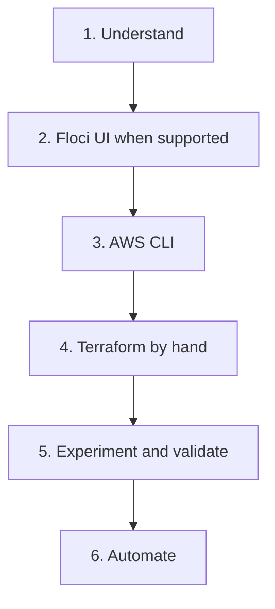

**English** · [Español](learning-methodology.es.md)

# Learning methodology

[Portfolio](../README.md)

The goal is to understand a system well enough to rebuild the important parts and explain the tradeoffs. Speed of automation comes after that.

## Order of work

1. Understand the technology.
2. Configure resources manually using the Floci UI when that service is supported.
3. Reproduce the operations using the AWS CLI.
4. Write the Terraform configuration by hand.
5. Experiment, troubleshoot, and validate.
6. Automate only after the manual path is understood.

## What each step is for

| Step | What you do | The step is still open if |
| --- | --- | --- |
| 1. Understand | Read the service model, the failure mode, and the boundary between the emulator and a real process. | The only record is a command that happened to succeed. |
| 2. Floci UI | Create or inspect the resource in the console when Floci supports it. | The console was available and was skipped. |
| 3. AWS CLI | Perform the same operation with the CLI against the local endpoint. | The CLI is still aimed at a real AWS endpoint, or the local URL was never set. |
| 4. Terraform | Write the configuration yourself and read every block you apply. | A generated file was applied and never read. |
| 5. Experiment | Change a parameter, break the path, read the error, fix it, and write down what was observed. | A green command is the only note. |
| 6. Automate | Script the path that is already understood: Make, CI, or GitOps. | The script is the first time the system is seen. |

Manual first, infrastructure as code second, automation third. Skipping to step 6 produces a lab that only the script can operate.

## Reconstruction

Project 01 is public again after a rebuild: Compose, Terraform, Floci, and an endpoint guard. Project 02 still has only a retired private copy with the suffix `-depr`, including Go. A published repository is evidence that a lab exists. It is not evidence that the manual path has been reconstructed.

Reconstruction means doing steps 1 through 5 against that lab and recording the result in the project repository: what was created in the UI, which CLI calls matched it, which Terraform blocks you can explain, and which failure you provoked on purpose. Until that record exists, this portfolio keeps the status `implemented_learning_pending`.

Do not mark a project Completed because a previous session left a passing test. Mark it Completed when this index and the project repository both agree that the learning reconstruction is done.

## Evidence

Useful evidence is a public repository, a walkthrough, an architecture note, an ADR, or a command log that states what was run and what came back.

This portfolio does not invent progress, test results, metrics, certifications, or deployment claims. It also does not copy those results out of a project README and present them as a new measurement. Link the record. Leave the observation in the repository that produced it.

A URL is evidence only after it has been opened and it resolves. A planned slug is a name, not a link.
