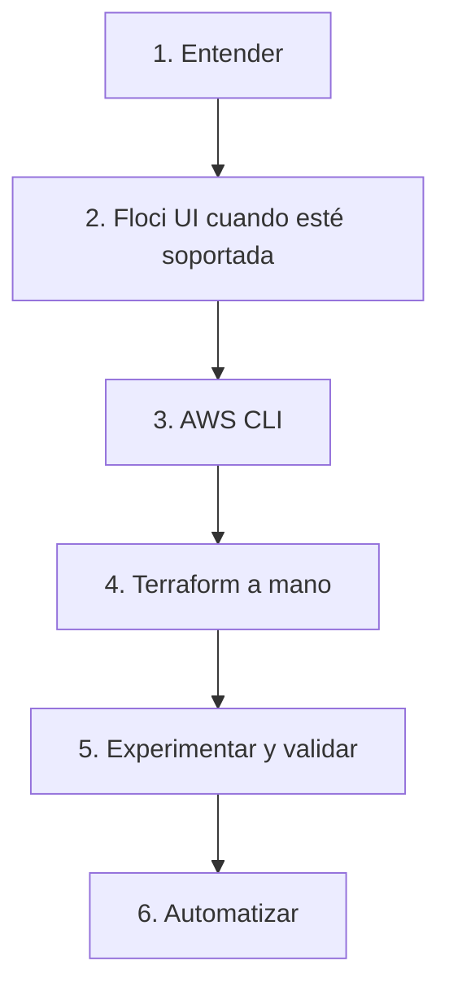

[English](learning-methodology.en.md) · **Español**

# Metodología de aprendizaje

[Portafolio](../README.es.md)

El objetivo es entender un sistema lo bastante bien como para reconstruir las partes importantes y explicar las decisiones. La velocidad de la automatización viene después.

## Orden de trabajo

1. Entender la tecnología.
2. Configurar los recursos a mano con la Floci UI cuando ese servicio está soportado.
3. Reproducir las operaciones con la AWS CLI.
4. Escribir la configuración de Terraform a mano.
5. Experimentar, diagnosticar y validar.
6. Automatizar solo después de entender el proceso manual.

## Para qué sirve cada paso

| Paso | Qué hay que hacer | El paso sigue abierto si |
| --- | --- | --- |
| 1. Entender | Leer el modelo del servicio, el modo de fallo y el límite entre el emulador y un proceso real. | El único registro es un comando que tuvo éxito. |
| 2. Floci UI | Crear o inspeccionar el recurso en la consola cuando Floci lo soporta. | La consola estaba disponible y se omitió. |
| 3. AWS CLI | Hacer la misma operación con la CLI contra el endpoint local. | La CLI sigue apuntando a un endpoint real de AWS, o la URL local nunca se configuró. |
| 4. Terraform | Escribir la configuración y leer cada bloque que se aplica. | Se aplicó un archivo generado y nadie lo leyó. |
| 5. Experimentar | Cambiar un parámetro, romper el camino, leer el error, corregirlo y anotar lo observado. | Un comando en verde es la única nota. |
| 6. Automatizar | Pasar a un script el camino que ya se entiende: Make, CI o GitOps. | El script es la primera vez que se ve el sistema. |

Manual primero, infraestructura como código después, automatización al final. Saltar al paso 6 produce un laboratorio que solo el script sabe operar.

## Reconstrucción

El proyecto 01 volvió a ser público después de rehacerlo: Compose, Terraform, Floci y una validación de endpoint. El proyecto 02 todavía tiene solo una copia privada retirada con el sufijo `-depr`, incluido Go. Un repositorio publicado es evidencia de que el laboratorio existe. No es evidencia de que el camino manual se haya reconstruido.

Reconstruir significa hacer los pasos 1 a 5 sobre ese laboratorio y dejar el resultado en el repositorio del proyecto: qué se creó en la UI, qué llamadas de la CLI coincidieron, qué bloques de Terraform se pueden explicar y qué fallo se provocó a propósito. Hasta que ese registro exista, este portafolio mantiene el estado `implemented_learning_pending`.

No hay que marcar un proyecto como Completado porque una sesión anterior haya dejado una prueba en verde. Se marca Completado cuando este índice y el repositorio del proyecto coinciden en que la reconstrucción del aprendizaje está hecha.

## Evidencia

La evidencia útil es un repositorio público, un recorrido guiado, una nota de arquitectura, un ADR o un registro de comandos que diga qué se ejecutó y qué respondió.

Este portafolio no inventa progreso, resultados de pruebas, métricas, certificaciones ni afirmaciones de despliegue. Tampoco copia esos resultados desde el README de un proyecto para presentarlos como una medición nueva. Hay que enlazar el registro. La observación se queda en el repositorio que la produjo.

Una URL es evidencia solo después de abrirla y comprobar que resuelve. Un slug planificado es un nombre, no un enlace.
