**English** · [Español](roadmap.es.md)

# Learning roadmap

[Portfolio](../README.md)

Eight projects, one curriculum. The order is a teaching sequence for this portfolio. It is not a claim that the industry can only learn these topics in this order.

## How the path is ordered

Each project adds one engineering concern and assumes the previous concern is available as a concept, even when its repository is still a reconstruction.

```mermaid
flowchart LR
  A["01 Cloud fundamentals"] --> B["02 Distributed systems"]
  B --> C["03 Containers and CI/CD"]
  C --> D["04 Observability and SRE"]
  D --> E["05 Kubernetes and GitOps"]
  E --> F["06 Security and governance"]
  F --> G["07 Streaming and analytics"]
  G --> H["08 Platform engineering"]
```

Early projects stay on one machine and one emulator account. Later projects add delivery, signals, a real local cluster, account boundaries, a data path, and then a platform that packages those paths for another engineer.

## Sequence

### 01 — Cloud fundamentals

Stand up Floci, point the AWS CLI and Terraform at it, and learn the infrastructure lifecycle: plan, apply, state, and destroy. The public lab creates an SQS queue next to S3 and DynamoDB. An earlier private copy remains under `floci-cloud-foundation-depr` and is not linked. The point of the stage is a lab you can rebuild, with a guard that refuses a non-local endpoint.

### 02 — Backend and distributed systems

Put a Go service behind an asynchronous flow. The useful ideas are idempotency, retries, compensation, and a dead-letter queue. A retired private copy, `floci-event-driven-commerce-depr`, already includes API Gateway, Lambda, DynamoDB, EventBridge, S3, SQS, and Step Functions. SNS is still part of the intended scope and is not in that Terraform. That copy is not the portfolio repository.

### 03 — Containers and CI/CD

Move from functions and queues to a container delivery path: image build, registry, a load-balanced service, a database, a cache, and a release strategy that includes blue/green. Jenkins is the real CI process. CodeBuild, CodePipeline, and CodeDeploy are AWS-compatible APIs and, on this path, belong on the emulator. This project is not published.

### 04 — Observability and SRE

Add signals before the platform grows. Metrics, logs, traces, alerts, SLOs, load with k6, and fault injection with Toxiproxy. CloudWatch is the emulated AWS side. Prometheus, Grafana, Loki, Grafana Alloy, OpenTelemetry, Jaeger, and Alertmanager are real local processes. This project is not published.

### 05 — Kubernetes and GitOps

Run a real k3s cluster as an EKS-compatible learning target. Package with Helm and Kustomize, constrain access with RBAC and IAM Pod Identity, and deliver desired state with Forgejo and Argo CD. k3s is not Amazon EKS. This project is not published.

### 06 — Cloud security and governance

Separate accounts and constrain what they can do. Organizations, IAM, STS, service control policies, and CloudTrail, expressed with Terraform. IAM task roles inside project 02 are not this design. This project is not published.

### 07 — Streaming and data engineering

Add a stream and a way to inspect it. MSK or Kinesis at the edge, Firehose into S3, then Glue, Athena, and OpenSearch for the analytical path. These are emulator APIs until a record says otherwise. This project is not published.

### 08 — Platform engineering

The capstone. Reusable Terraform modules, golden paths, and a self-service workflow that composes Kubernetes, CI/CD, GitOps, Jenkins, and observability. It should make the earlier labs easier for the next change, not collect every tool into one repository. This project is not published.

## Public repositories

Project 01 is public. Project 02 is not. Earlier private copies remain under `floci-cloud-foundation-depr` and `floci-event-driven-commerce-depr`. This roadmap does not link those retired copies and does not copy their command output.

| Project | Public URL | What this index treats as evidence |
| --- | --- | --- |
| 01 | [floci-cloud-foundation](https://github.com/keviingarciah/floci-cloud-foundation) | A public lab README, architecture note, state notes, and an illustrated walkthrough. Learning reconstruction is still pending. |
| 02 | None | A retired private copy. The portfolio lab will be rebuilt. Learning reconstruction is still pending. |

## Not started

Projects 03, 04, 05, 06, 07, and 08 have no GitHub repository in this index. Their status stays Planned until there is a repository and a record of what it actually contains. Do not link a URL that has not been opened and checked.
