[English](roadmap.en.md) · **Español**

# Hoja de ruta de aprendizaje

[Portafolio](../README.es.md)

Ocho proyectos, un plan de estudio. El orden es una secuencia de enseñanza para este portafolio. No afirma que la industria solo pueda aprender estos temas en este orden.

## Cómo está ordenado el camino

Cada proyecto agrega una preocupación de ingeniería y asume que la anterior ya está disponible como concepto, aunque su repositorio siga en reconstrucción.

```mermaid
flowchart LR
  A["01 Fundamentos de nube"] --> B["02 Sistemas distribuidos"]
  B --> C["03 Contenedores y CI/CD"]
  C --> D["04 Observabilidad y SRE"]
  D --> E["05 Kubernetes y GitOps"]
  E --> F["06 Seguridad y gobierno"]
  F --> G["07 Streaming y analítica"]
  G --> H["08 Ingeniería de plataforma"]
```

Los primeros proyectos se quedan en una máquina y en una cuenta del emulador. Los siguientes agregan entrega, señales, un clúster local real, límites entre cuentas, un camino de datos y, al final, una plataforma que empaqueta esos caminos para otro ingeniero.

## Secuencia

### 01 — Fundamentos de nube

Levantar Floci, apuntar la AWS CLI y Terraform hacia él, y aprender el ciclo de vida de la infraestructura: plan, apply, estado y destroy. El laboratorio público crea una cola de SQS junto a S3 y DynamoDB. Una copia privada anterior sigue bajo `floci-cloud-foundation-depr` y no se enlaza. El objetivo de la etapa es un laboratorio que se pueda reconstruir, con una validación que rechaza un endpoint que no sea local.

### 02 — Backend y sistemas distribuidos

Poner un servicio en Go detrás de un flujo asíncrono. Las ideas útiles son la idempotencia, los reintentos, la compensación y una cola de mensajes fallidos. Una copia privada retirada, `floci-event-driven-commerce-depr`, ya incluye API Gateway, Lambda, DynamoDB, EventBridge, S3, SQS y Step Functions. SNS sigue en el alcance previsto y no está en ese Terraform. Esa copia no es el repositorio del portafolio.

### 03 — Contenedores y CI/CD

Pasar de funciones y colas a un camino de entrega de contenedores: construcción de la imagen, registro, un servicio con balanceo, una base de datos, una caché y una estrategia de release que incluya blue/green. Jenkins es el proceso real de CI. CodeBuild, CodePipeline y CodeDeploy son APIs compatibles con AWS y, en este camino, corresponden al emulador. Este proyecto no está publicado.

### 04 — Observabilidad y SRE

Agregar señales antes de que la plataforma crezca. Métricas, logs, trazas, alertas, SLO, carga con k6 e inyección de fallos con Toxiproxy. CloudWatch es el lado emulado de AWS. Prometheus, Grafana, Loki, Grafana Alloy, OpenTelemetry, Jaeger y Alertmanager son procesos locales reales. Este proyecto no está publicado.

### 05 — Kubernetes y GitOps

Ejecutar un clúster real de k3s como objetivo de aprendizaje compatible con EKS. Empaquetar con Helm y Kustomize, limitar el acceso con RBAC e IAM Pod Identity, y entregar el estado deseado con Forgejo y Argo CD. k3s no es Amazon EKS. Este proyecto no está publicado.

### 06 — Seguridad y gobierno cloud

Separar cuentas y limitar lo que pueden hacer. Organizations, IAM, STS, políticas de control de servicios y CloudTrail, expresados con Terraform. Los roles de IAM para tareas del proyecto 02 no son este diseño. Este proyecto no está publicado.

### 07 — Streaming e ingeniería de datos

Agregar un stream y una forma de inspeccionarlo. MSK o Kinesis en el borde, Firehose hacia S3, y después Glue, Athena y OpenSearch para el camino analítico. Son APIs del emulador salvo que un registro diga lo contrario. Este proyecto no está publicado.

### 08 — Ingeniería de plataforma

El cierre. Módulos reutilizables de Terraform, rutas de referencia (golden paths) y un flujo de autoservicio que compone Kubernetes, CI/CD, GitOps, Jenkins y observabilidad. Debe hacer más fácil el siguiente cambio en los laboratorios anteriores, no juntar todas las herramientas en un solo repositorio. Este proyecto no está publicado.

## Repositorios públicos

El proyecto 01 es público. El proyecto 02 no. Las copias privadas anteriores siguen bajo `floci-cloud-foundation-depr` y `floci-event-driven-commerce-depr`. Esta hoja de ruta no enlaza esas copias retiradas y no copia la salida de sus comandos.

| Proyecto | URL pública | Qué trata como evidencia este índice |
| --- | --- | --- |
| 01 | [floci-cloud-foundation](https://github.com/keviingarciah/floci-cloud-foundation) | Un README público del laboratorio, una nota de arquitectura, notas de estado y un recorrido ilustrado. La reconstrucción del aprendizaje sigue pendiente. |
| 02 | Ninguna | Una copia privada retirada. El laboratorio del portafolio se va a rehacer. La reconstrucción del aprendizaje sigue pendiente. |

## Sin empezar

Los proyectos 03, 04, 05, 06, 07 y 08 no tienen repositorio de GitHub en este índice. Su estado sigue en Planificado hasta que exista un repositorio y un registro de lo que realmente contiene. No hay que enlazar una URL que no se haya abierto y comprobado.
