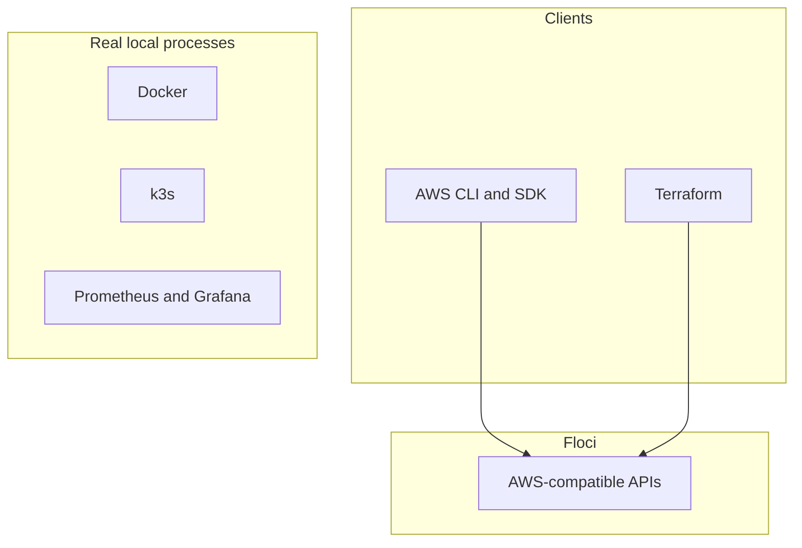

**English** · [Español](technology-stack.es.md)

# Technology stack

[Portfolio](../README.md)

## How to read this list

Tools are grouped by the job they do on this path. Product names stay in English.

The status column is not a skill score.

| Status | Meaning |
| --- | --- |
| Seen in a private repository | This tool was present in the retired private copy of project 01 or 02, renamed with the suffix `-depr`. The portfolio lab will be rebuilt. This index does not link that copy. |
| No lab published yet | The tool is part of the curriculum. No published lab in this portfolio shows it yet. |

The review date for that split is 2026-10-18.

| Kind | Meaning |
| --- | --- |
| Emulated API | An AWS-compatible API answered by Floci. |
| Real process | A program that actually runs on the machine. |
| Client | Real software pointed at Floci or at a local process. |

## Emulated APIs and real processes

k3s, Prometheus, and Grafana are on the diagram because they are the shape of later projects. They are not running as part of a published lab in this index. Docker is already how projects 01 and 02 start Floci.

Pointing Terraform at Floci does not make Terraform an emulator. The AWS provider is a client. The resources it creates are emulator state.

## Categories

### Emulation and clients

| Tool | Role | Kind | Portfolio status |
| --- | --- | --- | --- |
| Floci | Local AWS-compatible emulator | Real process | Seen in a private repository |
| Floci UI | Console for resources the emulator supports | Real process | Seen in a private repository |
| AWS CLI | Manual operations against the local endpoint | Client | Seen in a private repository |
| AWS SDK | Go SDK calls from the project 02 functions | Client | Seen in a private repository |

### Infrastructure as code

| Tool | Role | Kind | Portfolio status |
| --- | --- | --- | --- |
| Terraform | Hand-written configuration and lifecycle | Client | Seen in a private repository |

### Application runtime

| Tool | Role | Kind | Portfolio status |
| --- | --- | --- | --- |
| Go | Application language for backend labs | Real process | Seen in a private repository |
| Docker | Container runtime used to start the labs | Real process | Seen in a private repository |
| Docker Compose | Per-lab process definition | Real process | Seen in a private repository |

### AWS-compatible integration

| Tool | Role | Kind | Portfolio status |
| --- | --- | --- | --- |
| Lambda | Function compute in the order lab | Emulated API | Seen in a private repository |
| API Gateway | HTTP API in front of those functions | Emulated API | Seen in a private repository |
| Step Functions | Saga orchestration for fulfillment | Emulated API | Seen in a private repository |
| SQS | Queues, including a dead-letter queue | Emulated API | Seen in a private repository |
| SNS | Topic fan-out in the project 02 scope | Emulated API | No lab published yet |
| EventBridge | Order and fulfillment events | Emulated API | Seen in a private repository |
| S3 | Objects for lab state and receipts | Emulated API | Seen in a private repository |
| DynamoDB | Table storage for the labs | Emulated API | Seen in a private repository |

IAM task roles used by those functions are listed under security. API Gateway authorization is called out by the project 02 README as optional follow-up, so this row does not treat authorization as finished.

### Delivery

| Tool | Role | Kind | Portfolio status |
| --- | --- | --- | --- |
| ECS | Service runtime for the container lab | Emulated API | No lab published yet |
| ECR | Image registry API for that lab | Emulated API | No lab published yet |
| ALB | Load balancer API for that lab | Emulated API | No lab published yet |
| Jenkins | Real CI server | Real process | No lab published yet |
| CodeBuild | Build API on the emulator | Emulated API | No lab published yet |
| CodePipeline | Pipeline API on the emulator | Emulated API | No lab published yet |
| CodeDeploy | Deployment API on the emulator | Emulated API | No lab published yet |

### Kubernetes and GitOps

k3s is a real cluster. Calling it EKS-compatible describes the learning target. It does not create an Amazon EKS control plane.

| Tool | Role | Kind | Portfolio status |
| --- | --- | --- | --- |
| k3s | Local Kubernetes cluster | Real process | No lab published yet |
| Kubernetes | Workload API of that cluster | Real process | No lab published yet |
| Helm | Package install and upgrade | Real process | No lab published yet |
| Kustomize | Overlay-based configuration | Real process | No lab published yet |
| Argo CD | GitOps controller | Real process | No lab published yet |
| Forgejo | Git remote for the GitOps loop | Real process | No lab published yet |
| RBAC | Access control inside the cluster | Real process | No lab published yet |
| IAM Pod Identity | Workload identity against emulated IAM | Emulated API | No lab published yet |

### Data

Redis on this path is a real local process, not an emulated ElastiCache API, unless a future lab record says otherwise. The AWS analytics services below are emulator APIs.

| Tool | Role | Kind | Portfolio status |
| --- | --- | --- | --- |
| RDS | Relational database API | Emulated API | No lab published yet |
| Redis | Local cache | Real process | No lab published yet |
| MSK | Managed Kafka-compatible stream | Emulated API | No lab published yet |
| Kinesis | Stream API | Emulated API | No lab published yet |
| Firehose | Delivery into object storage | Emulated API | No lab published yet |
| Glue | Catalog and batch processing API | Emulated API | No lab published yet |
| Athena | SQL over objects | Emulated API | No lab published yet |
| OpenSearch | Search API | Emulated API | No lab published yet |

### Observability

CloudWatch here means metrics, logs, and alarms. Event delivery in project 02 is listed as EventBridge, not as this row.

| Tool | Role | Kind | Portfolio status |
| --- | --- | --- | --- |
| CloudWatch | Metrics, logs, and alarms | Emulated API | No lab published yet |
| Prometheus | Metrics store | Real process | No lab published yet |
| Grafana | Dashboards | Real process | No lab published yet |
| Loki | Log store | Real process | No lab published yet |
| Grafana Alloy | Telemetry collector | Real process | No lab published yet |
| OpenTelemetry | Traces and metrics pipeline | Real process | No lab published yet |
| Jaeger | Trace backend | Real process | No lab published yet |
| Alertmanager | Alert routing | Real process | No lab published yet |
| k6 | Load generation | Real process | No lab published yet |
| Toxiproxy | Fault injection | Real process | No lab published yet |

### Security and governance

| Tool | Role | Kind | Portfolio status |
| --- | --- | --- | --- |
| IAM | Task roles in the project 02 lab. Account governance belongs to project 06. | Emulated API | Seen in a private repository |
| STS | Temporary credentials and role assumption | Emulated API | No lab published yet |
| AWS Organizations | Account structure | Emulated API | No lab published yet |
| SCP | Service control policies | Emulated API | No lab published yet |
| CloudTrail | API audit trail | Emulated API | No lab published yet |

When a new lab is published, update the matching row in both language files and the lists in `scripts/validate_portfolio.py`. The procedure is in the [metadata schema](../projects/schema.en.md).
