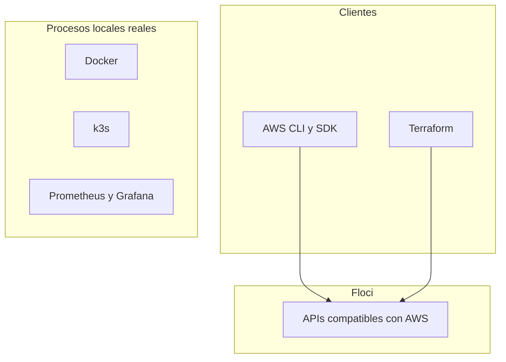

[English](technology-stack.en.md) · **Español**

# Stack tecnológico

[Portafolio](../README.es.md)

## Cómo leer esta lista

Las herramientas se agrupan por la función que cumplen en este camino. Los nombres de producto se mantienen en inglés.

La columna de estado no es una puntuación de habilidad.

| Estado | Significado |
| --- | --- |
| Visto en un repositorio privado | Esta herramienta estaba en la copia privada retirada del proyecto 01 o 02, renombrada con el sufijo `-depr`. El laboratorio del portafolio se va a rehacer. Este índice no enlaza esa copia. |
| Aún no hay laboratorio publicado | La herramienta forma parte del plan de estudio. Ningún laboratorio publicado de este portafolio la muestra todavía. |

La fecha de esa separación es 2026-10-18.

| Tipo | Significado |
| --- | --- |
| API emulada | Una API compatible con AWS respondida por Floci. |
| Proceso real | Un programa que sí se ejecuta en la máquina. |
| Cliente | Software real apuntando a Floci o a un proceso local. |

## APIs emuladas y procesos reales

k3s, Prometheus y Grafana están en el diagrama porque son la forma de proyectos posteriores. No están en ejecución como parte de un laboratorio publicado en este índice. Docker ya es la forma en que los proyectos 01 y 02 arrancan Floci.

Apuntar Terraform a Floci no convierte a Terraform en un emulador. El provider de AWS es un cliente. Los recursos que crea son estado del emulador.

## Categorías

### Emulación y clientes

| Herramienta | Función | Tipo | Estado en el portafolio |
| --- | --- | --- | --- |
| Floci | Emulador local compatible con AWS | Proceso real | Visto en un repositorio privado |
| Floci UI | Consola para los recursos que el emulador soporta | Proceso real | Visto en un repositorio privado |
| AWS CLI | Operaciones manuales contra el endpoint local | Cliente | Visto en un repositorio privado |
| AWS SDK | Llamadas del SDK de Go desde las funciones del proyecto 02 | Cliente | Visto en un repositorio privado |

### Infraestructura como código

| Herramienta | Función | Tipo | Estado en el portafolio |
| --- | --- | --- | --- |
| Terraform | Configuración escrita a mano y ciclo de vida | Cliente | Visto en un repositorio privado |

### Runtime de aplicaciones

| Herramienta | Función | Tipo | Estado en el portafolio |
| --- | --- | --- | --- |
| Go | Lenguaje de aplicación para los laboratorios de backend | Proceso real | Visto en un repositorio privado |
| Docker | Runtime de contenedores con el que arrancan los laboratorios | Proceso real | Visto en un repositorio privado |
| Docker Compose | Definición de procesos de cada laboratorio | Proceso real | Visto en un repositorio privado |

### Integración compatible con AWS

| Herramienta | Función | Tipo | Estado en el portafolio |
| --- | --- | --- | --- |
| Lambda | Cómputo de funciones en el laboratorio de pedidos | API emulada | Visto en un repositorio privado |
| API Gateway | API HTTP delante de esas funciones | API emulada | Visto en un repositorio privado |
| Step Functions | Orquestación de la saga de cumplimiento | API emulada | Visto en un repositorio privado |
| SQS | Colas, incluida una cola de mensajes fallidos | API emulada | Visto en un repositorio privado |
| SNS | Fan-out por temas en el alcance del proyecto 02 | API emulada | Aún no hay laboratorio publicado |
| EventBridge | Eventos de pedido y de cumplimiento | API emulada | Visto en un repositorio privado |
| S3 | Objetos para el estado del laboratorio y los recibos | API emulada | Visto en un repositorio privado |
| DynamoDB | Almacenamiento en tablas para los laboratorios | API emulada | Visto en un repositorio privado |

Los roles de IAM que usan esas funciones están en la sección de seguridad. El README del proyecto 02 señala la autorización de API Gateway como seguimiento opcional, así que esta fila no trata esa autorización como trabajo terminado.

### Entrega

| Herramienta | Función | Tipo | Estado en el portafolio |
| --- | --- | --- | --- |
| ECS | Runtime de servicio para el laboratorio de contenedores | API emulada | Aún no hay laboratorio publicado |
| ECR | API de registro de imágenes para ese laboratorio | API emulada | Aún no hay laboratorio publicado |
| ALB | API de balanceador para ese laboratorio | API emulada | Aún no hay laboratorio publicado |
| Jenkins | Servidor real de CI | Proceso real | Aún no hay laboratorio publicado |
| CodeBuild | API de build en el emulador | API emulada | Aún no hay laboratorio publicado |
| CodePipeline | API de pipeline en el emulador | API emulada | Aún no hay laboratorio publicado |
| CodeDeploy | API de despliegue en el emulador | API emulada | Aún no hay laboratorio publicado |

### Kubernetes y GitOps

k3s es un clúster real. Llamarlo compatible con EKS describe el objetivo de aprendizaje. No crea un plano de control de Amazon EKS.

| Herramienta | Función | Tipo | Estado en el portafolio |
| --- | --- | --- | --- |
| k3s | Clúster local de Kubernetes | Proceso real | Aún no hay laboratorio publicado |
| Kubernetes | API de cargas de ese clúster | Proceso real | Aún no hay laboratorio publicado |
| Helm | Instalación y actualización de paquetes | Proceso real | Aún no hay laboratorio publicado |
| Kustomize | Configuración por overlays | Proceso real | Aún no hay laboratorio publicado |
| Argo CD | Controlador de GitOps | Proceso real | Aún no hay laboratorio publicado |
| Forgejo | Remoto Git para el ciclo de GitOps | Proceso real | Aún no hay laboratorio publicado |
| RBAC | Control de acceso dentro del clúster | Proceso real | Aún no hay laboratorio publicado |
| IAM Pod Identity | Identidad de carga contra el IAM emulado | API emulada | Aún no hay laboratorio publicado |

### Datos

Redis en este camino es un proceso local real, no una API emulada de ElastiCache, salvo que un laboratorio futuro lo registre de otra forma. Los servicios de analítica de AWS de abajo son APIs del emulador.

| Herramienta | Función | Tipo | Estado en el portafolio |
| --- | --- | --- | --- |
| RDS | API de base de datos relacional | API emulada | Aún no hay laboratorio publicado |
| Redis | Caché local | Proceso real | Aún no hay laboratorio publicado |
| MSK | Stream compatible con Kafka administrado | API emulada | Aún no hay laboratorio publicado |
| Kinesis | API de streams | API emulada | Aún no hay laboratorio publicado |
| Firehose | Entrega hacia almacenamiento de objetos | API emulada | Aún no hay laboratorio publicado |
| Glue | API de catálogo y procesamiento por lotes | API emulada | Aún no hay laboratorio publicado |
| Athena | SQL sobre objetos | API emulada | Aún no hay laboratorio publicado |
| OpenSearch | API de búsqueda | API emulada | Aún no hay laboratorio publicado |

### Observabilidad

CloudWatch aquí significa métricas, logs y alarmas. La entrega de eventos del proyecto 02 está listada como EventBridge, no como esta fila.

| Herramienta | Función | Tipo | Estado en el portafolio |
| --- | --- | --- | --- |
| CloudWatch | Métricas, logs y alarmas | API emulada | Aún no hay laboratorio publicado |
| Prometheus | Almacén de métricas | Proceso real | Aún no hay laboratorio publicado |
| Grafana | Tableros | Proceso real | Aún no hay laboratorio publicado |
| Loki | Almacén de logs | Proceso real | Aún no hay laboratorio publicado |
| Grafana Alloy | Colector de telemetría | Proceso real | Aún no hay laboratorio publicado |
| OpenTelemetry | Canal de trazas y métricas | Proceso real | Aún no hay laboratorio publicado |
| Jaeger | Backend de trazas | Proceso real | Aún no hay laboratorio publicado |
| Alertmanager | Enrutamiento de alertas | Proceso real | Aún no hay laboratorio publicado |
| k6 | Generación de carga | Proceso real | Aún no hay laboratorio publicado |
| Toxiproxy | Inyección de fallos | Proceso real | Aún no hay laboratorio publicado |

### Seguridad y gobierno

| Herramienta | Función | Tipo | Estado en el portafolio |
| --- | --- | --- | --- |
| IAM | Roles de tarea en el laboratorio del proyecto 02. El gobierno de cuentas corresponde al proyecto 06. | API emulada | Visto en un repositorio privado |
| STS | Credenciales temporales y asunción de roles | API emulada | Aún no hay laboratorio publicado |
| AWS Organizations | Estructura de cuentas | API emulada | Aún no hay laboratorio publicado |
| SCP | Políticas de control de servicios | API emulada | Aún no hay laboratorio publicado |
| CloudTrail | Registro de auditoría de la API | API emulada | Aún no hay laboratorio publicado |

Cuando se publique un laboratorio nuevo, hay que actualizar la fila correspondiente en los dos idiomas y las listas de `scripts/validate_portfolio.py`. El procedimiento está en el [esquema de metadatos](../projects/schema.es.md).
